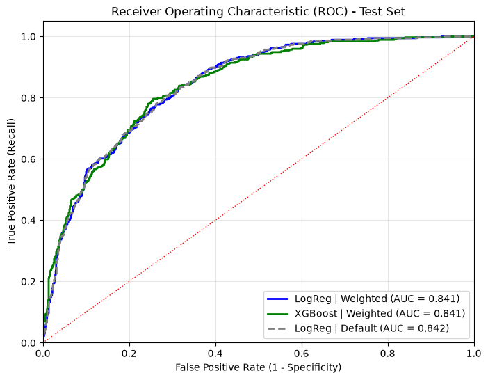
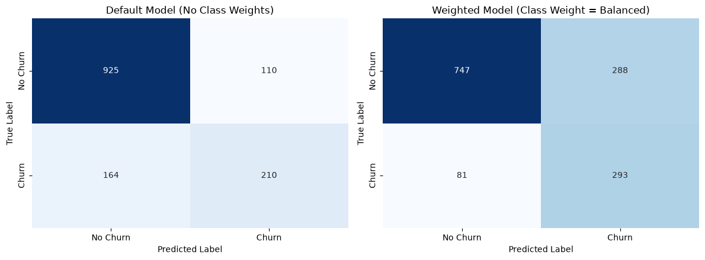
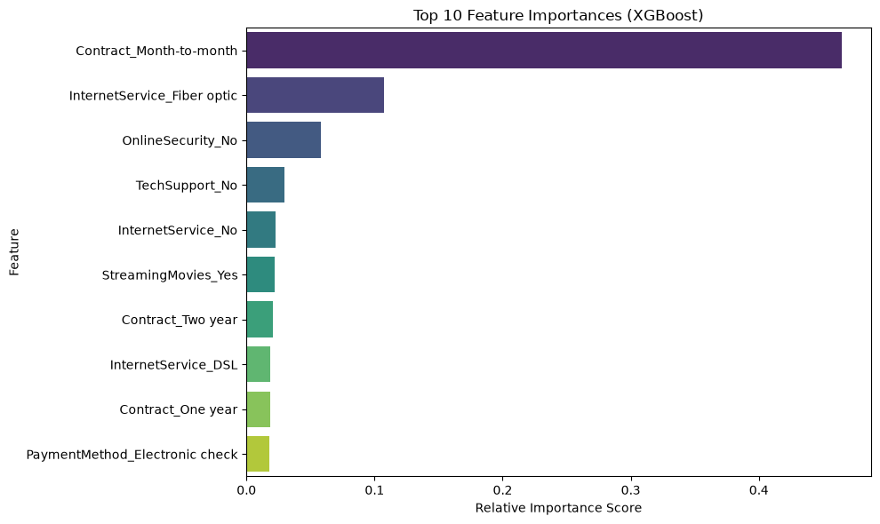

# Predictive Customer Churn - Telco

Binary classification of customer churn on the IBM Telco Customer Churn dataset.
Compares Logistic Regression, Random Forest, and XGBoost under class-weighted
vs. unweighted training, evaluated with stratified 5-fold cross-validation and
a held-out test set. Primary metric: **ROC-AUC** (target > 0.80).

---

## Table of Contents

- [Overview](#overview)
- [Dataset](#dataset)
- [Approach](#approach)
- [Results](#results)
- [Project Structure](#project-structure)
- [How to Run](#how-to-run)
- [Key Findings](#key-findings)

---

## Overview

Customer churn — a subscriber leaving the service — is one of the highest-value
prediction problems in telecom. This project builds and compares three classifiers
for churn prediction, with explicit attention to **class imbalance** (~26.5% churners)
and **threshold-independent evaluation** (ROC-AUC).

**Questions this notebook answers:**

1. How much does class weighting improve recall without hurting ROC-AUC?
2. Does XGBoost meaningfully beat a logistic-regression baseline on tabular data?
3. Which customer attributes drive churn most strongly?

---

## Dataset

- **Source:** [IBM Telco Customer Churn](https://raw.githubusercontent.com/IBM/telco-customer-churn-on-icp4d/master/data/Telco-Customer-Churn.csv) (public, loaded directly from the URL)
- **Size:** 7,043 customers × 21 columns
- **Target:** `Churn` (binary: Yes/No → 1/0), **26.5% positive**
- **Features:** demographics (`gender`, `SeniorCitizen`, `Partner`, `Dependents`),
  account info (`tenure`, `Contract`, `PaymentMethod`, `PaperlessBilling`),
  services (`PhoneService`, `InternetService`, `OnlineSecurity`, …),
  billing (`MonthlyCharges`, `TotalCharges`)

**Data-quality notes handled:**

- `TotalCharges` is delivered as a string with 11 blank values (customers with
  `tenure = 0`). Coerced to numeric; blanks filled to 0 (new customers, not missing-at-random).
- `customerID` is an identifier and is dropped before modeling.
- `No internet service` / `No phone service` are structural states, not missing values.
- No numeric outliers flagged by IQR fences.

---

## Approach

| Step | What was done |
|---|---|
| **Split** | 80/20 stratified train/test, `random_state=42` |
| **Preprocessing** | `ColumnTransformer`: median-impute + standard-scale numeric features; most-frequent-impute + `OneHotEncoder(drop='if_binary', handle_unknown='ignore')` for categoricals — all inside a `Pipeline` so it is fit per fold |
| **Imbalance handling** | Class weighting: `class_weight='balanced'` (LR), `'balanced_subsample'` (RF), `scale_pos_weight≈2.77` (XGB). Chosen over SMOTE because the 2.8:1 ratio is moderate and ROC-AUC is threshold-independent — documented in the notebook |
| **Models** | Logistic Regression (baseline), Random Forest (300 trees), XGBoost (300 trees, lr=0.05, depth=4) — each in **both** weighted and unweighted variants |
| **Cross-validation** | `StratifiedKFold(n_splits=5, shuffle=True, random_state=42)`, same folds for all 6 pipelines |
| **Metrics** | ROC-AUC (primary), F1, precision, recall |
| **Evaluation** | ROC curves, confusion matrices, top-10 feature importances |

---

## Results
[]

### Cross-validation (5-fold, mean ± std)

*Target Metric: ROC-AUC > 0.80 — Achieved by all models.*

| Model Variant | ROC-AUC | F1-Score | Precision | Recall |
| :--- | :--- | :--- | :--- | :--- |
| **LogReg \| weighted** | **0.8459** | 0.629 | 0.517 | **0.801** |
| LogReg \| default | 0.8461 | 0.592 | 0.652 | 0.544 |
| XGBoost \| default | 0.8445 | 0.580 | 0.656 | 0.520 |
| XGBoost \| weighted | 0.8443 | 0.631 | 0.532 | 0.777 |
| RandomForest \| weighted | 0.8239 | 0.542 | 0.634 | 0.473 |
| RandomForest \| default | 0.8231 | 0.548 | 0.634 | 0.483 |

### Held-out test set (primary variant: [XGBoost | weighted])

| Metric | Value |
|---|---|
| ROC-AUC | 0.8415 |
| XGBoost (Weighted) ROC-AUC | 0.8409 |
| Default Model ROC-AUC | 0.8418 |

**Target met:** ROC-AUC is well above the 0.80 threshold, and the test set scores closely match the CV scores, proving the model generalizes well.

### Figures

**ROC Curves**

**Confusion Matrices (Default vs Weighted)**

**Top 10 Feature Importances (XGBoost)**

**Note:** *While Logistic Regression was our best-performing model for classification (highest ROC-AUC), we will use XGBoost to extract Feature Importances. Logistic Regression coefficients are highly sensitive to multicollinearity (specifically the 'No internet service' dummy variables in this dataset), which creates misleading negative coefficients. XGBoost's tree-based architecture handles these structural states cleanly, providing a much more reliable and interpretable ranking of the true churn drivers.*
---

## Project Structure

Predictive Customer Churn/
├── README.md
├── notebook/
│ └── Predictive Customer Churn Classifier.ipynb
├── figures/
│ ├── roc_curve.png
│ ├── confusion_matrix_logreg.png
│ └── feature_importance_xgboost.png
├── requirements.txt